# Hawlak MVP

Hawlak delivers an approved post-discharge plan as an Arabic voice note through WhatsApp, collects medicine-box photos, and creates a pharmacist-review task. The AI changes wording and dialect only; it never changes clinical facts or decides whether a medicine is correct.

## Team boundary

| Area | Owner | Repository path |
|---|---|---|
| Product direction, dialect AI, Arabic voice, WhatsApp, inbound media | Haya | `apps/api/` |
| Pharmacist and care-team dashboard | Retaj | `apps/dashboard/` |
| Event schemas and integration contract | Haya + Retaj | `packages/contracts/` and `docs/integration-contract.md` |
| Clinical wording and safety review | Medical team | Pull-request review of fixtures and prompts |

Neither application imports the other. They communicate through versioned contracts.

## MVP architecture



Editable Mermaid sources are in `docs/architecture/`.

## Start locally

Requirements: Node.js 22+, npm, Docker, and ffmpeg.

```bash
cp .env.example .env
npm install
docker compose up -d
npm run dev:api
```

Check the service:

```bash
curl http://localhost:3000/health
```

## Configure WhatsApp

Follow [the Meta WhatsApp test-number setup](docs/setup/whatsapp-meta.md). The first milestone is:

1. Meta verifies the webhook at `GET /webhooks/whatsapp`.
2. A signed inbound message reaches `POST /webhooks/whatsapp`.
3. `POST /internal/demo/send-text` sends a message to the verified test recipient.

## Repository rules

- Never commit `.env` or patient data.
- Use synthetic patients and fictional medicines only.
- Changes to `packages/contracts` require review from both Haya and Retaj.
- No dashboard code belongs in `apps/api`.
- No AI, WhatsApp, or media-processing code belongs in `apps/dashboard`.
- Clinical output is not sent until its exact script has been reviewed and approved.

## Branch workflow

- `main` must stay demo-ready.
- Haya works from `haya/<feature>` branches.
- Retaj works from `retaj/<feature>` branches.
- Use pull requests even during the hackathon for shared-contract changes.
- Squash merge small features; tag the final demo as `v0.1.0-demo`.

## Current status

The repository contains a runnable WhatsApp webhook and outbound text-message scaffold. AI voice generation, persistence, and dashboard implementation are separate next milestones.

