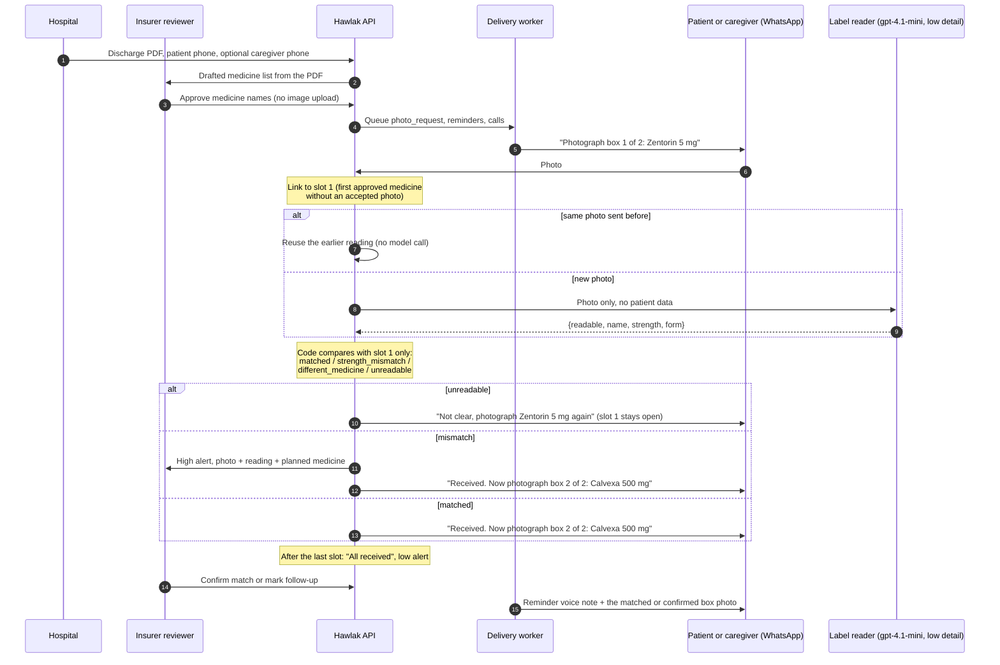

# Medicine-photo check

Status: implemented on `haya/complete-prototype`, 13 November 2026.

## What it does

The insurer approves the medicine list by name. After approval, Hawlak asks the
patient on WhatsApp to photograph each approved box, one at a time and by name.
Each photo is linked to the medicine it was requested for (its slot). The check
then only asks: does this box match that one medicine?

- Only the patient's side takes photos: the patient, or a caregiver registered at
  intake. The insurer dashboard has no image upload.
- The link from photo to medicine is deterministic. It comes from the request
  order, never from the model.
- A box sent out of order is the one exception. When the label fails the
  requested medicine and code matches it to exactly one other approved medicine
  still waiting, the photo is linked there and Hawlak asks again for the
  missing box. No match, or more than one, keeps the requested slot and alerts
  a person.
- The model only reads the printed label. Code decides the result.
- The patient never gets a verdict. A mismatch becomes an alert for a person.

## Flow

## Design

| Part | Where | Notes |
|---|---|---|
| Caregiver phone | `PatientCase.caregiver_phone_e164`, intake field `caregiverPhoneE164` | Must differ from the patient phone. Photos from any other number are ignored |
| Photo request | Delivery run `photo_request`, created at approval when any medicine is dispensed | Text names the first approved medicine. Sent as WhatsApp text |
| Slot linking | `InboundWorkflow._check_photo` | Slot = first dispensed medicine, in plan order, with no accepted photo. Unreadable photos keep the slot open. A box that fails its slot but matches exactly one other waiting medicine is linked to that one |
| Label reader | `medicine_photos.OpenAILabelReader`, prompt `medicine-label-v1.txt` | Returns name, strength, form, readable. Never names, numbers or sticker text |
| Comparison | `medicine_photos.compare_reading(reading, medication)` | Name-word overlap with the approved display name, then strength numbers. Pure code |
| Replies | `medicine_photos.PHOTO_REPLIES` | request, next, retake, complete, received_extra. Only approved medicine names are filled in |
| Alerts | `medicine_photo_mismatch` (high), `medicine_photos_ready` (low) | Confirming a photo resolves its mismatch alert |
| Reviewer | Insurer **Medicine photos** tab, `POST /workspace/cases/{id}/photos/{photoId}/review` | Decision: `confirmed` or `follow_up` |
| Caregiver view | `photoStatus` per medicine | missing, received, needs_attention, confirmed |
| Reminder image | `journey_delivery._patient_photo_key` | Latest matched (not marked follow-up) or confirmed patient photo. Without one, the voice reminder goes alone |
| Data | `inbound_media`: `sender_role`, `label_reading`, `check_status`, `medication_id`, review fields | Migrations 0004 and 0005 |

## Cost

What keeps it cheap:

1. **Slot linking.** The model never searches the medicine list. It reads one
   label, and code compares with one medicine.
2. **Low image detail.** Each read uses a small, fixed image budget. Box print is
   large text, so low detail is enough.
3. **Read once.** An identical photo (same SHA-256) reuses the earlier reading.
4. **No read when nothing is expected.** Extra photos after the last slot are
   stored for a person without a model call.
5. **Mock mode reads nothing.** Every photo waits for a person, at no model cost.
6. **Model is a setting.** `OPENAI_VISION_MODEL` defaults to `gpt-4.1-mini`; a
   smaller model can be tried with the same tests.

At about one read per medicine, cost is a few hundred input tokens per photo,
well under one US cent each. Check current OpenAI pricing before quoting a
number.

Possible next step: try a free on-server OCR first, and call the model only when
OCR finds no approved name. That adds a dependency and is only worth it at volume.

## Checklist

- [x] Caregiver phone at intake, validated against the patient phone
- [x] Photos accepted from the patient or the caregiver only
- [x] Insurer image upload removed; approval no longer needs an image
- [x] `photo_request` run after approval, naming the first approved medicine
- [x] Deterministic slot linking; unreadable keeps the slot
- [x] Label read with low detail, read once per identical photo
- [x] Code comparison with the one expected medicine
- [x] Fixed replies that name only approved medicines
- [x] Mismatch and all-received alerts
- [x] Reviewer tab with confirm or follow-up
- [x] Caregiver photo status
- [x] Reminders use the matched or confirmed patient photo, or go voice-only
- [x] Out-of-order photos link to their own waiting medicine instead of raising an alert
- [x] Tests: API 247, dashboard 19; live reader checked with synthetic boxes
- [x] Photo request sent as a WhatsApp template when `WHATSAPP_PHOTO_REQUEST_TEMPLATE` is set
- [ ] Create that template in Meta and get it approved (see below)
- [ ] Recorded caregiver consent and revocation
- [ ] Arabic-only plan names: add a Latin name or code so they can match a box
- [ ] Contract review of `caregiverPhoneE164`, `medicinePhotos` and `photo_request` by Haya and Retaj
- [ ] Optional OCR-first path if volume makes model reads matter

## WhatsApp template

Meta delivers plain text only within 24 hours of the patient's last message. The
photo request is the first message after approval, so it needs an approved
template. The code sends the template when `WHATSAPP_PHOTO_REQUEST_TEMPLATE` is
set, and plain text otherwise.

Create one template in Meta, category Utility, in languages `ar` and `en`, with
exactly the wording of `PHOTO_REPLIES["request"]` (`medicine_photos.template_body`
returns it, and a test keeps the two the same):

| Language | Body |
|---|---|
| `ar` | فضلاً صوّر علبة الدواء رقم {{1}} من {{2}}، واسمه {{3}}، وأرسل الصورة هنا. |
| `en` | Please photograph medicine box {{1}} of {{2}}, named {{3}}, and send it here. |

`{{1}}` is the box number, `{{2}}` the number of boxes and `{{3}}` the approved
medicine name. After Meta approves it, set the variable in `.env`, run
`deploy/aws/sync_keys.sh`, and the next photo request uses it. The follow-up
replies (next box, retake, complete) stay plain text: they answer a photo, so
they are always inside the window.
