# Hawlak platform, data flow, and privacy boundary

**Status date:** 12 November 2026  
**Scope:** Platform architecture, data movement, privacy, and implementation status.  
**Not in scope:** Model benchmarks, medical efficacy claims, or a legal opinion.

This document uses the repository and its accepted architecture decisions as the
source of truth. It does not treat the proposed flow as fully implemented. The
current AWS demo runs in `mock` mode. No provider has completed a live patient
delivery from this deployment.

## Status terms

- **Implemented:** Code and tests exist, or the repository documents an active
  mock deployment.
- **In progress:** The main code path exists, but credentials, provider setup,
  live rehearsal, or a required control is incomplete.
- **Planned:** The repository describes the design, but the end-to-end feature
  does not exist.
- **Unverified:** Hawlak has not verified an external guarantee, contract, or
  production property.

## 1. System diagram

The editable Mermaid source is
[`platform-data-flow.mmd`](platform-data-flow.mmd). Solid lines show the primary
MVP flow. Dashed lines show the planned Saudi-hosted link alternative.

The insurer actor means an authorized integrated-care clinical reviewer. It does
not mean underwriting, pricing, claims, or general insurance staff. ADR 0001 and
ADR 0002 require this separation. The demo login has only one broad `insurer`
role, so production-grade clinical-role enforcement remains planned.

## 2. Component-by-component data flow

The labels below have a strict meaning:

- **Confirmed:** Present in the repository or its current deployment documents.
- **Assumption:** Used for the design, but not proven.
- **Open question:** A decision or external fact that the pilot owner must
  confirm.

| Step and component | Receives | Processes | Stores | Sends | Status and limits |
|---|---|---|---|---|---|
| 1. Hospital workspace | Discharge PDF, registered patient name, optional preferred form of address, phone number, insurer member ID, language, and dialect | Validates the file and creates a case | No durable browser storage is intended | PDF and intake fields to the Hawlak API | **Confirmed / Implemented.** The production hospital integration and lawful basis are open questions. |
| 2. Workflow API and private storage | Hospital intake and PDF bytes | Validates file type, size, and case ownership | PDF or medicine images in S3-compatible object storage; structured case data in PostgreSQL | PDF text to the parser; case data to authorized views | **Confirmed / Implemented.** Current AWS demo storage is outside Saudi Arabia. Encryption configuration, retention, deletion, and backup location are **unverified** for production. |
| 3. PDF parser | A PDF with a text layer | Extracts headings, medications, stopped medicines, instructions, and warning signs with deterministic rules | Extraction is returned to the workflow; the source PDF remains in object storage | Structured extraction to the drafter and reviewer | **Confirmed / Implemented.** Scanned or unusual PDFs need manual entry until OCR exists. |
| 4. Draft and fidelity guard | Parsed discharge facts, reviewed medication rows, patient language, and an address label | Creates an editable voice-note, reminder, and call draft. The guard checks medicine names, dose numbers, and other numbers | Generated draft and reviewer edits in the care journey | Draft to the authorized reviewer only | **Confirmed / Implemented.** Template drafting works in mock mode. The external drafting path is optional. No draft can be sent before approval. |
| 5. Eligibility boundary | Member ID and case ID | Uses a deterministic mock to return eligibility and enrollment data | Eligibility result and enrollment reference in the journey record | Coverage result to the integrated-care reviewer | **Confirmed / Implemented as a mock.** A real insurer API, processor role, and allowed identifier are **open questions**. A national ID must not be reused as a member ID without an approved need and control. |
| 6. Integrated-care review | Source PDF, extraction, draft, medication images, coverage result, and call schedule | Reviews and edits exact content. Approves the case. Approval makes patient-facing content immutable | Reviewer identifier, approval time, approved content, and scheduled delivery runs | Approved runs to the worker | **Confirmed / Implemented.** The demo role is broader than the proposed licensed clinical role. Production authorization is **planned**. |
| 7. Delivery worker | Due approved runs, phone number, exact script, and approved image reference | In mock mode, records a simulated result. In live mode, renders speech and dispatches WhatsApp or a call | Delivery status and provider reference | Exact script to the speech provider; minimized media and routing number to Meta; call-plan ID to the call service | **Implemented in mock mode; live delivery is in progress.** Provider contracts, residency, and a real rehearsal are **unverified**. |
| 8. WhatsApp boundary | Recipient phone number, rendered audio, approved medication image, fixed button prompt, and later inbound replies | Meta routes media and messages. Hawlak verifies signed webhooks, matches the sender to a case, validates media, and records `taken` or `not_yet` | Hawlak stores message metadata, delivery status, minimal normalized payload, and approved inbound images. Meta's storage and processing are external | Voice note, image, and buttons to the patient; signed webhook events to Hawlak | **Adapter and webhook implemented; live production sender in progress.** Meta account state, template approval, E2EE boundary, processing location, and retention are **unverified**. |
| 9. Follow-up call | Approved call-plan ID; at call time, the routing number and approved questions | Places a call, transcribes a reply, classifies it as clear, red flag, uncertain, or transfer request, and follows the deterministic approved state machine | Hawlak stores only terminal status, approved question ID, and answer category. It does not intentionally store the raw transcript in this path | Call media to demo telephony and speech processors; transfer to the approved responder; minimal outcome to Hawlak | **Code implemented; live operation in progress.** Outbound calling, Arabic recognition, carrier routing, and SIP transfer are **unverified**. |
| 10. Red-flag follow-up | Minimal call outcome with question ID and answer category | Creates an alert when a call transfers or fails after a red flag, uncertainty, or transfer request | Alert and workflow event | Alert count to the caregiver view; identifiable alert detail to the authorized care team | **Implemented in code; live behavior unverified.** Clinical ownership, response time, and after-hours escalation are **open questions**. |
| 11. Caregiver view | Case reference | Returns a restricted projection | No additional clinical record | Patient label, medication names, reminder-active state, next call, and alert count | **Implemented.** It does not show the source PDF, phone, scripts, or insurance fields. It does **not** yet show the patient's `taken` or `not_yet` acknowledgement. Production invitation, consent, and identity proofing are **planned**. |

### Important implementation distinction

Hawlak already records WhatsApp button replies. The pharmacist-review timeline
can show the latest reply. The caregiver projection currently reports only
`scheduled` or `needs_support`. Therefore, “caregivers can see whether the dose
was acknowledged” is **planned**, not implemented.

## 3. Data minimization and PII masking

### Required patient-facing rule

Patient-facing text, audio, templates, and URLs must not contain:

- the registered full name;
- national ID or Iqama number;
- insurer member or policy number;
- medical-record number;
- internal case ID;
- a full phone number; or
- the source PDF filename.

Use a generic greeting or an explicitly approved preferred form of address. Do
not fall back to the registered full name. Examples of safe display values are:

- patient: `[PATIENT]`;
- national ID: `**********`;
- member ID: `******1234`;
- phone in an authorized internal view: `+9665*****123`.

The phone number still has to go to the selected messaging or telephone provider
for routing. Masking the user interface does not remove that provider disclosure.

### Implemented gate and remaining gap

**Implemented (12 November 2026):** `find_identifier` in
`apps/api/app/services/patient_identifiers.py` checks every text that approval
will send: the voice note, the active reminders, and the call scripts and
questions. Approval fails with `patient_text_contains_identifier` if any of them
contains one of these:

- the registered full name (two or more words);
- the patient's phone number, in Western or Arabic digits and with any separators;
- a 10-digit Saudi national or Iqama number;
- the member or policy number;
- the case ID; or
- the source filename.

The drafter no longer falls back to `patientName`. It greets with no name unless
a preferred form of address was approved. The call service receives
`participantLabel = "patient"` instead of the registered name. The live drafting
payload drops `label: value` notes that name or number the patient, but keeps
emergency numbers.

**Remaining gap:**

- The caregiver projection still returns `patientName`.
- The gate catches only identifiers Hawlak knows about, plus the Saudi ID
  pattern. Another person's name, or an unknown record number, still depends on
  human review.

### Minimum data by boundary

| Boundary | Minimum necessary data | Must stay out |
|---|---|---|
| Hospital to Hawlak | Case reference, routing phone, approved patient label, language, relevant discharge PDF, and member ID only if eligibility needs it | Unrelated history, claims, pricing notes, and duplicate identity documents |
| Hawlak to drafting service | Relevant discharge instructions, reviewed medicines, language, and a pseudonymous label | Full name, phone, member ID, policy number, national ID, source filename, and caregiver identity |
| Hawlak to speech renderer | Exact approved script and voice configuration | Source PDF, member ID, phone, insurance record, and caregiver data |
| Hawlak to Meta | Routing phone, minimized approved audio or text, approved medicine image, and fixed reply controls | Source PDF, national or member ID, policy data, reviewer identity, internal notes, and full name |
| Hawlak to call providers | Routing phone, approved questions, approved transfer number, and the live audio needed for the call | Source PDF, member ID, policy data, and unrelated discharge content |
| Hawlak to caregiver | Authorized patient label, acknowledgement state, next follow-up time, and action-needed indicator | Source PDF, phone, national or member ID, insurance data, internal notes, raw transcript, and responder phone |
| Logs and analytics | Opaque case or run ID, event type, status, timestamp, provider reference, and phone suffix only when essential | Full message body, full transcript, raw audio, full phone, access token, and signed URL |

### Storage and retention requirements

Before a real pilot, the data owner must define and enforce:

1. one retention period for source PDFs and medication images;
2. one shorter period for generated audio and provider media;
3. one retention period for delivery and audit events;
4. deletion propagation to backups and processors;
5. encryption-key ownership and rotation;
6. access logging for every sensitive read; and
7. a process for correction, withdrawal, and legal hold.

These controls are not proven by the current mock deployment.

## 4. Threat-model summary

### WhatsApp E2EE assumption

**Assumption — unverified for Hawlak's exact Business Platform configuration:**
WhatsApp states that its chats use end-to-end encryption and that only the
sender and intended recipient can read message content. Meta also states that an
E2EE guarantee depends on control of the endpoints. Hawlak must confirm the
Business Platform and Cloud API boundary in Meta's current documentation,
contract, and deployed account before using E2EE as a security claim.

Under that assumption, E2EE helps protect WhatsApp message content against an
intermediary while the message moves between WhatsApp endpoints. It does not
protect content at every Hawlak or provider processing point.

It does **not** by itself protect against:

- Hawlak seeing the approved plaintext before it sends the message;
- a speech provider receiving the approved script;
- Meta's Business Platform endpoint processing the routing number and uploaded
  media;
- metadata such as phone numbers, timestamps, sender, recipient, and message
  type;
- storage in Hawlak databases, object stores, logs, backups, or business tools;
- a compromised, shared, unlocked, or backed-up patient or staff device;
- screenshots, downloads, copying, or forwarding by an authorized recipient;
- delivery to the wrong phone number;
- content that a user reports to WhatsApp;
- retention or data residency; or
- lawful access, processor access, or support access outside the encrypted chat.

Official background sources:

- [WhatsApp key transparency and the E2EE model](https://engineering.fb.com/2023/04/13/security/whatsapp-key-transparency/)
- [Meta's explanation that an E2EE promise depends on endpoint control](https://engineering.fb.com/2024/03/06/security/whatsapp-messenger-messaging-interoperability-eu/)
- [WhatsApp reporting can disclose recent reported business messages](https://faq.whatsapp.com/1805617343145907)

### Main threats and present controls

| Threat | Existing MVP control | Remaining gap |
|---|---|---|
| An unauthorized user views a clinical case | Demo login tokens and route-level hospital, insurer, caregiver, and admin checks | Production identity, organization membership, clinical-role separation, MFA, session controls, and periodic access review are planned |
| A full identifier enters patient-facing content | Human review, plus an automatic gate that blocks approval when known identifiers or a Saudi ID pattern appear; generic greeting when no approved form of address exists | Unknown names or record numbers still depend on human review |
| A draft changes a clinical fact | Number, medicine-name, and dose fidelity guard; exact human approval; approved content becomes immutable | Clinical validation for all free-text facts and source-version change control need pilot governance |
| A forged WhatsApp webhook changes state | Meta `X-Hub-Signature-256` verification | Live configuration and key rotation are unverified |
| A provider retries the same event | Idempotency keys and unique message or workflow-event records | Cross-provider reconciliation and operational replay tooling need live testing |
| A malicious file reaches storage | Size, type, signature, and case-path checks | Malware scanning, content disarm, quarantine, and scanned-PDF OCR controls are planned |
| A red flag is missed or a transfer fails | Uncertain results fail toward transfer; failed transfers produce an alert outcome | Live SIP transfer, staffed response ownership, service levels, and downtime fallback are unverified |
| A caregiver guesses a case reference | Role-scoped caregiver route | Per-patient invitations, relationship verification, revocation, and object-level authorization are planned |
| A link or audio is shared from a device | None can fully prevent an authorized recipient from sharing | Patient notice, short retention, minimal content, and authenticated link access reduce impact |
| External processing leaves Saudi Arabia | Separate demo and Saudi production profiles are documented | Current AWS demo is in `eu-north-1`; Saudi hosting and all processor routes remain unverified |

### Out of scope for this MVP threat model

- a guarantee that a patient or caregiver device is not compromised;
- security certification of Meta, AWS, LiveKit, Telnyx, OpenAI, ElevenLabs, an
  SMS carrier, or a future Saudi host;
- telecom lawful-intercept behavior;
- production disaster recovery and business continuity;
- clinical effectiveness or diagnosis accuracy;
- a PDPL compliance determination; and
- a conclusion that any external provider processes data in Saudi Arabia.

## 5. Alternative for stricter Saudi data-residency needs

This is a **planned** flow. It is not present in the current repository.

1. Keep the hospital intake, reviewer workflow, database, object storage,
   speech rendering, logs, backups, and key management in an approved Saudi
   environment.
2. Create the exact audio only after authorized clinical approval.
3. Store the audio in a private Saudi object store. Do not expose the object key.
4. Create a random, short-lived access token. Keep all PII, case IDs, and member
   IDs out of the URL.
5. Send an SMS with neutral wording, for example: “Your discharge audio is
   ready.” Include the short-lived link.
6. Ask for a second factor before playback when the risk assessment requires it.
   An OTP bound to the intended phone is one option.
7. Stream the audio after verification. Do not return a permanent public URL.
8. Expire the token after first use or a short time. Log only the minimum access
   event.

### Trade-off

This flow adds a link, a browser, and possibly an OTP. It is harder for older
patients and people with low digital literacy. It can reduce the benefit of the
no-click WhatsApp experience.

SMS is not end-to-end encrypted. A bearer link can be opened by anyone who can
read or forward the message. A link sent through WhatsApp has the same endpoint
risk: a person with access to the patient's phone or chat, or a recipient of a
forwarded link, may open it unless Hawlak requires separate authentication.

“Hosted in Saudi Arabia” is not established by the object-store location alone.
The team must also verify the application runtime, database, CDN, DNS, logs,
analytics, backups, identity provider, support access, SMS carrier, and every
subprocessor. The current AWS demo in `eu-north-1` does not meet a strict Saudi
residency design.

## 6. Component status view

| Component | Status | Evidence and limitation |
|---|---|---|
| Bilingual hospital intake | **Implemented** | PDF upload, patient fields, language, dialect, and member ID exist |
| Private PDF and image storage | **Implemented** | S3-compatible storage adapter and AWS S3 demo path exist; production controls are not verified |
| Text-layer PDF extraction | **Implemented** | Deterministic `pypdf` parser; no OCR for scanned PDFs |
| Patient-friendly draft and fidelity guard | **Implemented** | Template path, optional external path, and deterministic guard exist |
| Mock eligibility and enrollment | **Implemented** | Deterministic mock only |
| Real insurer-system integration | **Planned** | No production insurer API is configured |
| Insurer review, editing, approval, and scheduling | **Implemented** | Approval creates immutable content and delivery runs |
| Production clinical-role separation | **Planned** | ADRs define it; demo auth has one broad insurer role |
| AWS-hosted demo | **Implemented** | Repository documents CloudFront, EC2, S3, SSM, and mock mode; this review did not independently inspect the account |
| Delivery queue and worker | **Implemented** | Runs operate in mock mode and clearly show simulated delivery |
| Meta WhatsApp adapter and signed webhook | **Implemented** | Code and tests exist |
| Meta production sender, templates, and real delivery | **In progress** | Account, payment, templates, credentials, and rehearsal are incomplete |
| WhatsApp `1` or `2` acknowledgement capture | **Implemented** | Inbound button reply is recorded as `taken` or `not_yet` |
| Caregiver view | **Implemented** | Restricted case projection exists |
| Caregiver acknowledgement visibility | **Planned** | Current caregiver state is reminder-active, not taken/not-yet |
| LiveKit and Telnyx call agent | **In progress** | Deterministic code and tests exist; live route and transfer are not proven |
| Red-flag call outcome and alert | **Implemented** | Minimal outcome, workflow event, and alert creation exist in code |
| Real staffed red-flag response | **Unverified** | Responder ownership, hours, and service levels are not confirmed |
| Patient-facing PII rejection gate | **Implemented** | Blocks approval on known identifiers and Saudi ID pattern; no registered-name fallback |
| Caregiver label minimization | **Planned** | Caregiver projection still returns the registered name |
| Production caregiver consent and access | **Planned** | Case-reference lookup is a prototype only |
| WhatsApp E2EE boundary for Hawlak Cloud API | **Unverified** | Treat as an assumption until current account and contract review |
| Saudi data residency | **Unverified** | Current demo is outside Saudi Arabia |
| Saudi-hosted audio with SMS link | **Planned** | Architecture option only |
| Retention, deletion, backup, and processor schedule | **Planned** | Must be defined before real data |

## 7. Assumptions and open questions to resolve before a pilot

1. **Assumption:** The hospital already has an approved path to send the relevant
   discharge record to the integrated-care program.
2. **Open question:** Which organization is the PDPL controller for each purpose,
   and which parties are processors or independent controllers?
3. **Open question:** Is `memberId` an insurer identifier, a national ID, or a
   derived token? Hawlak should use a scoped insurer identifier, not a national
   ID, when possible.
4. **Open question:** Which licensed role can approve discharge content,
   medication images, red-flag questions, and transfer targets?
5. **Open question:** How does the patient authorize a named caregiver, and how
   can the patient revoke that access?
6. **Open question:** What is the required response time for each red-flag
   severity, including nights and weekends?
7. **Open question:** What are the retention periods for PDFs, images, audio,
   message metadata, call outcomes, and audit events?
8. **Open question:** Which approved Saudi providers will host application,
   storage, speech, telephone, logs, backups, and support access?
9. **Open question:** Which messages require a Meta template, and what neutral
   fallback is used when the WhatsApp service window is closed?
10. **Known limitation:** Scanned PDFs and unfamiliar hospital formats can
    require manual entry and review.

## Repository evidence used

- [`README.md`](../../README.md)
- [`CHAT_HANDOFF.md`](../../CHAT_HANDOFF.md)
- [`care_journeys.py`](../../apps/api/app/routes/care_journeys.py)
- [`care_journey_service.py`](../../apps/api/app/services/care_journey_service.py)
- [`discharge_parser.py`](../../apps/api/app/services/discharge_parser.py)
- [`journey_drafter.py`](../../apps/api/app/services/journey_drafter.py)
- [`journey_delivery.py`](../../apps/api/app/services/journey_delivery.py)
- [`inbound_workflow.py`](../../apps/api/app/services/inbound_workflow.py)
- [`livekit_worker.py`](../../apps/agent/src/hawlak_agent/livekit_worker.py)
- [`ADR 0001`](../adr/0001-insurer-funded-integrated-care-boundary.md)
- [`ADR 0002`](../adr/0002-separate-service-eligibility-from-clinical-approval.md)
- [`ADR 0003`](../adr/0003-separate-demo-and-saudi-production-provider-profiles.md)
- [`AWS demo deployment`](../../deploy/aws/README.md)

